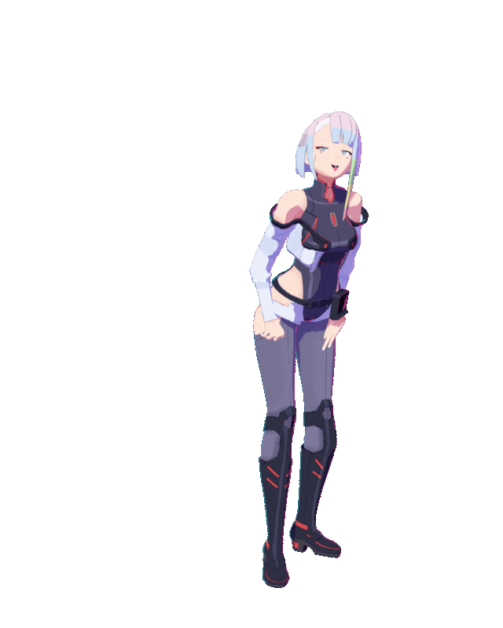
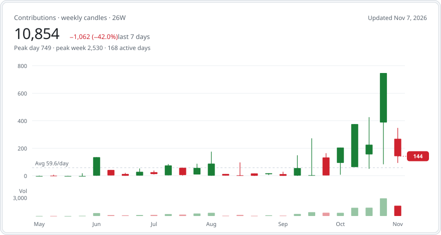

<!-- markdownlint-disable MD033 MD041 -->

<picture>
  <source srcset="assets/lucy-3d-v3.webp" type="image/webp" />
  
</picture>

# Rade Nugroho

**FDE, ontology-driven, agentic enterprise systems.**

## GitHub stats

## Most used languages

<picture>
  <source media="(max-width: 600px) and (prefers-color-scheme: dark)" srcset="assets/top-langs-dark-compact.svg" />
  <source media="(max-width: 600px)" srcset="assets/top-langs-light-compact.svg" />
  <source media="(prefers-color-scheme: dark)" srcset="assets/top-langs-dark.svg" />
  
</picture>

## Activity

<picture>
  <source media="(max-width: 600px) and (prefers-color-scheme: dark)" srcset="assets/contrib-candles-dark-compact.svg" />
  <source media="(max-width: 600px)" srcset="assets/contrib-candles-light-compact.svg" />
  <source media="(prefers-color-scheme: dark)" srcset="assets/contrib-candles-dark.svg" />
  
</picture>

Last updated: October 2026
