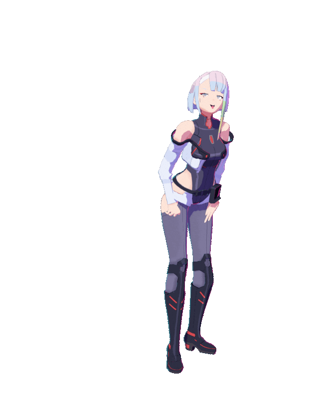
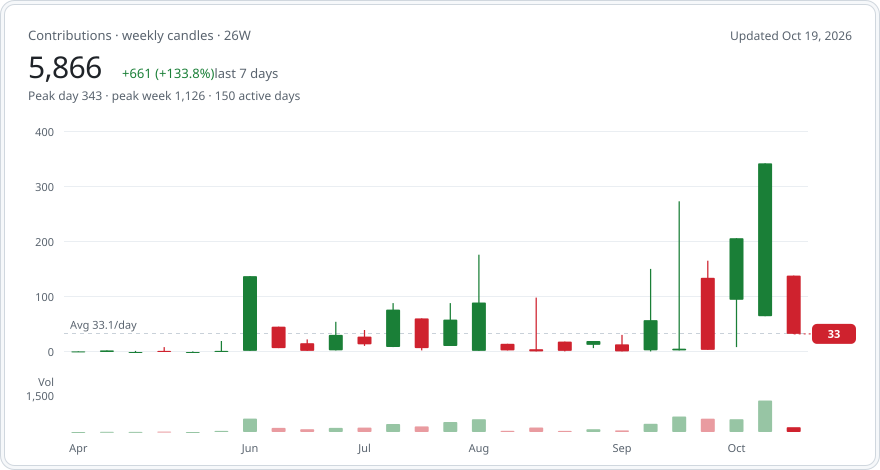

<!-- markdownlint-disable MD033 MD041 -->

<picture>
  <source srcset="assets/lucy-3d-v3.webp" type="image/webp" />
  
</picture>

# Rade Nugroho

**FDE, ontology-driven, agentic enterprise systems.**

## What I'm building

- **[TANTIRA](https://github.com/TANTIRA)**: an ontology-driven, agentic enterprise stack.
  - **Mesta-TMS-WMS**: transport and warehouse management where AI agents plan, execute, track and settle operations end to end. *Rust*
  - **Mesta-Foundry**: an enterprise data operating system. *Python*
  - **Raven**: a common operating picture and target workbench, with geospatial COP, ontology APIs and a defense OSDK. *Python*
- **[daemonprotocol](https://github.com/daemonprotocol)**: decision intelligence for AML and compliance investigations, covering data fusion, entity resolution, graph analytics and case management.
- **Open source**: deterministic Solana program auditing, agentic OSINT and detection engineering.

## Selected open work

| Project | What it does | Stack |
| --- | --- | --- |
| **[ARES-v3](https://github.com/rade-nugroho/ARES-v3)** | Deterministic static audit of Solana smart contracts through multi-phase taint tracking and macro-aware AST parsing. | Rust |
| **[Solana-Ontology-SDK](https://github.com/rade-nugroho/Solana-Ontology-SDK)** | A data-logic-action layer for Solana built on an ontology system. | TypeScript |
| **[MORDOR](https://github.com/rade-nugroho/MORDOR)** | Malware orchestration and reverse-engineering detection runtime. | Python |
| **[project-raven-d3fend](https://github.com/rade-nugroho/project-raven-d3fend)** | Proactive threat hunting, grounded in CDP and aligned to D3FEND. | Python |
| **[Grond](https://github.com/rade-nugroho/Grond)** | Agentic open-source intelligence. | Python |
| **[Agentic-Enteprises-Skill](https://github.com/rade-nugroho/Agentic-Enteprises-Skill)** | An agent skill for enterprise workflows. | Python |
| **[Octo](https://github.com/TANTIRA/OCTO)** | A machine-verifiable book of record for machine-native money. | Kotlin |

## Activity

<picture>
  <source media="(prefers-color-scheme: dark)" srcset="assets/contrib-candles-dark.svg" />
  
</picture>

Last updated: October 2026
